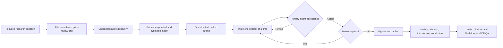

<div align="center">

# Review Loom · 织论

**From a focused research question to an evidence-grounded narrative review.**

[English](#review-loom--织论) · [简体中文](#简体中文)


[Download PNG](assets/brand/review-loom-poster.png) · [Editable SVG source](assets/brand/review-loom-poster.svg)

*An autonomous, publication-oriented workflow for literature discovery, synthesis, delegated writing, figures, citations, and PDF production.*

</div>

## What it does

Review Loom is a project-level agent skill for building a **focused narrative review** from a clearly framed research question. It coordinates literature discovery, evidence appraisal, cross-study synthesis, sequential chapter writing, visual production, reference integration, and final document checks.

The workflow is designed to run without routine human intervention after launch. A primary agent coordinates specialized subagents, checks each chapter before the next begins, and sends rejected work back for delegated revision.

> **Scope:** Review Loom supports narrative reviews. It is not a systematic-review or meta-analysis workflow, and it does not claim that a generated manuscript is accepted or publication-ready without venue-specific review.

## The workflow



### Built around evidence, not a pile of search results

- **Narrow the question first.** A bounded pilot search tests whether the question is answerable, compares prior reviews, and records the contribution and synthesis gap before full discovery.
- **Search across complementary sources.** Bundled direct API adapters query arXiv and Crossref. A host-provided web-search tool may add candidate discovery when available; its coverage and limits are logged.
- **Synthesize before outlining.** Study appraisal and a cross-study synthesis matrix inform the outline. Sections map to the question and synthesis units instead of mirroring search-result titles.
- **Write sequentially with an acceptance gate.** The primary agent ranks chapters by importance and delegates them one at a time. It inspects and accepts a chapter before dispatching the next; rejected prose returns to a subagent for revision.
- **Create visuals from the accepted manuscript.** Figures are generated as final images, checked against the accepted plan and source evidence, and revised by a subagent when they fail review. Draw.io is not required.
- **Unify citations at assembly.** Stable source keys are retained during chapter drafting; numbering is resolved once for the complete manuscript, so a paper cited in multiple chapters has one reference number.
- **Finish with checked Markdown and PDF.** Markdown is canonical. DOCX is not produced by default.

## Manuscript targets

The default minimums are **40 distinct cited works**, with **at least 60% from the latest five publication years**, plus **five figures** and **four tables** in the main manuscript. Typical planning ranges are 5–8 figures and 4–6 tables, subject to venue limits and explanatory value.

These are evidence and presentation targets, not permission to pad. If relevant literature or reliable evidence cannot support a target after bounded searching, the workflow reports a limited result rather than inventing or forcing content.

## What a run contains

Each review is kept in its own directory. The default structure makes the research trail and deliverables easy to inspect:

```text
<run-name>/
├── 01_plan/       scope, core question, outline, section manifest
├── 02_search/     queries, search logs, prior-review comparison
├── 03_sources/    source records and screening decisions
├── 04_evidence/   claims, appraisals, synthesis matrix
├── 05_sections/  delegated chapter drafts and acceptance records
├── 06_figures/    figure plan, final PNGs, evidence and review records
├── 07_manuscript/ assembled source manuscript and tables
├── 08_audit/      validation reports and quality checks
├── submission/    readable Markdown and verified PDF
└── run-state.json phase state and orchestration history
```

The exact manuscript filenames may vary with the run. PDF intermediates, rendered pages, metrics, and a contact sheet are retained for inspection.

## Get started

Install the `review-loom` directory as a project skill so the file is available at:

```text
<your-project>/.agents/skills/review-loom/SKILL.md
```

Then ask your coding agent to use **`$review-loom`** and provide a topic or, preferably, a proposed research question. The skill begins by sharpening the scope and testing it with a pilot search.

### Host capabilities and dependencies

Review Loom supplies its workflow, search adapters, validation scripts, templates, and PDF renderer. The agent host supplies model access, subagent delegation, network permission, and (for generated figures) an image-generation capability. Those tools are not bundled into this repository, and availability depends on the host.

- **Literature search:** direct adapters for arXiv and Crossref; no other database API adapter is bundled. Hosted web search is optional and is recorded as candidate discovery, not exhaustive database retrieval.
- **Default outputs:** citation-key Markdown, readable citation-resolved Markdown, and PDF. No Draw.io Desktop installation is needed; figures are PNGs generated directly for the manuscript.
- **PDF workflow:** the full default renderer requires Pandoc, Python Playwright with an installed Chromium browser, PyMuPDF, and Pillow. If a required component is missing, the run records the limitation and does not claim a verified PDF.

## Included design references

Eight bundled reference figures guide visual style for generated review figures. They are **style references**, not sources of scientific content; figure claims and labels must come from the accepted evidence and manuscript plan. Their known sources and separate license status are listed in [ASSET-ATTRIBUTION.md](ASSET-ATTRIBUTION.md).

## License and asset note

The original Review Loom skill, scripts, documentation, and project-created brand artwork are licensed under the [MIT License](LICENSE). The eight images in `assets/Reference Figures/` are excluded from MIT and have separate source and rights status, documented in [ASSET-ATTRIBUTION.md](ASSET-ATTRIBUTION.md). Some image permissions remain unresolved; repository inclusion does not grant reuse rights.

---

<details>
<summary><strong>简体中文</strong></summary>

### 织论是什么

**织论（Review Loom）** 是一个项目级 Agent Skill，用于从清晰、聚焦的研究问题出发，协同完成叙述性综述的检索、证据评价、跨研究综合、逐章写作、配图、统一引文和 PDF 校验。

启动后，主代理负责统筹并依次委派子代理。上一章必须经主代理验收，下一章才能开始；不合格内容交回子代理修改，避免误差和论证漂移逐章累积。默认流程面向叙述性综述，不是系统综述或 Meta 分析。

### 主要特点

- 先用范围明确的试检索评估问题可回答性、既有综述覆盖和本文贡献，再进入正式检索。
- 内置 arXiv 与 Crossref API 适配器；宿主提供的网页搜索可作为补充发现路径，并记录其覆盖边界。
- 先建立研究评价和跨研究综合矩阵，再据此形成并排序大纲，而不是照搜索结果标题拼章节。
- 按重要性逐章委派；主代理验收后才启动下一章，返修仍交给子代理。
- 正文稳定后生成至少 5 张图、4 个表；图片直接生成最终 PNG，并由主代理对照论文证据审核。无需 Draw.io。
- 全文组装后统一解析引用编号；默认产出 Markdown 和经过校验的 PDF，不默认生成 DOCX。

### 最低目标

默认至少引用 **40 篇不同文献**，其中**近五年文献不少于 60%**；正文至少 **5 张图、4 个表**。如果相关证据无法支撑这些目标，织论应报告受限结果，不得为了凑数而加入无关文献或编造内容。

### 安装与运行

将 `review-loom` 目录放在项目的 `.agents/skills/review-loom/` 下，确保 `SKILL.md` 路径为：

```text
<项目目录>/.agents/skills/review-loom/SKILL.md
```

之后让 Agent 使用 **`$review-loom`**，并给出主题或研究问题。它会先收敛问题并试检索。运行依赖宿主具备子代理委派、网络访问，以及生成配图所需的图像生成能力。

PDF 全流程依赖 Pandoc、带 Chromium 浏览器的 Python Playwright、PyMuPDF 和 Pillow。缺少依赖时会记录限制，不会声称 PDF 已通过完整校验。

### 许可说明

织论原创的 skill、脚本、文档与项目海报采用 [MIT 许可证](LICENSE)。`assets/Reference Figures/` 下的 8 张图不属于 MIT 授权范围，来源与已知许可见 [ASSET-ATTRIBUTION.md](ASSET-ATTRIBUTION.md)；其中部分图片的再分发权限仍未确认，收录不代表获得复用权。

</details>
